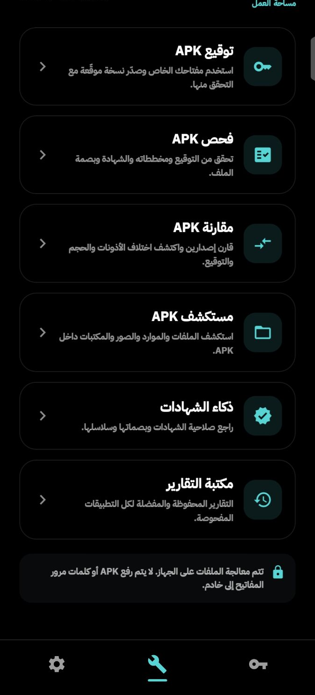
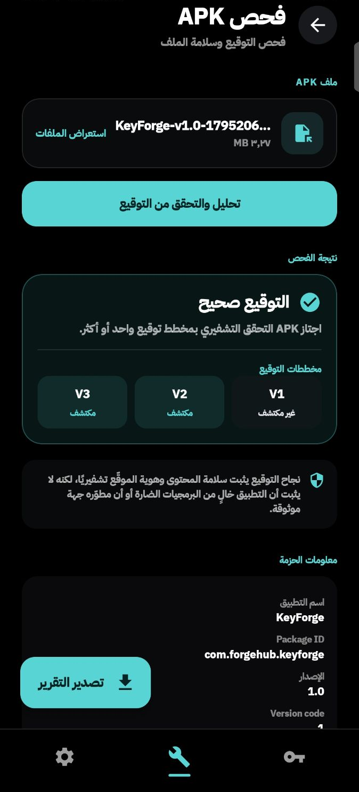
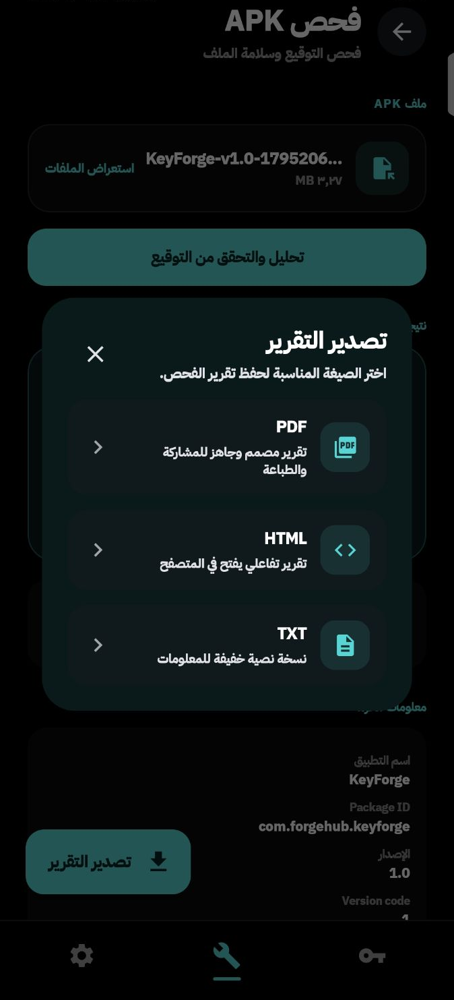

<h1>ShueibHub | Forge</h1>

<i>Building practical software with a focus on simplicity, usefulness, and a clean user experience.</i>

 

**[Projects](#projects)** &nbsp;•&nbsp; **[KeyForge](#keyforge)** &nbsp;•&nbsp; **[ProgForge](#progforge)** &nbsp;•&nbsp; **[Approach](#approach)** &nbsp;•&nbsp; **[Contact](#contact--links)**

🌐 **English** &nbsp;|&nbsp; **[العربية](#arabic)**

## About

**ShueibHub | Forge** is the personal development space of **ShueibHub** — a home for selected projects, applications, and experiments.

The goal is straightforward:

> 🔨 **Build** useful tools &nbsp;→&nbsp; ✨ **Keep** them simple &nbsp;→&nbsp; 🔁 **Improve** them through real feedback

## Projects

Selected apps from the Forge — practical tools, kept simple.

| | Project | What it is | Platform | Version | Download |
|:-:|:--|:--|:-:|:-:|:-:|
| 🔑 | **[KeyForge](#keyforge)** | Keystore & app-signing utility | Android | v1.0 | [⬇️ APK](https://github.com/ShueibHub/ShueibHub-Forge/releases/download/1.0/KeyForge-v1.0.apk) |
| ⌨️ | **[ProgForge](#progforge)** | Programming-focused keyboard | Android | v1.0 | [⬇️ APK](https://github.com/ShueibHub/ShueibHub-Forge/releases/download/v1.0/ProgForge-v1.0.apk) |

### KeyForge

> **An Android utility for working with Android keystores and app signing.**

- 🔐 **Keystore & signing tools** — manage signing keys and Keystore files, and verify app signatures.
- 📱 **On-device first** — core functionality is designed to stay on the user's device.
- 🚫 **A clean experience** — no advertising, no in-app purchases, and no private application servers.
- 🔄 **Updates via GitHub** — uses GitHub to check for update information.

 

### ProgForge

> **A programming-focused keyboard for Android, designed to make coding on mobile devices easier, faster, and more comfortable.**

- ⌨️ **Symbols at your fingertips** — convenient access to programming symbols and characters.
- 💻 **Built for developers** — designed with developers and programmers in mind.
- 📱 **A better mobile coding experience** — improves the way you code on a phone.
- ⚡ **Always within reach** — essential coding characters are readily accessible while typing.

 

### Installation

Both apps are distributed as APK files through GitHub Releases.

<b>📥 How to install an APK on Android</b>

 

1. Download the APK from the project's download button.
2. Open the downloaded file from your notifications or file manager.
3. If prompted, allow your browser or file manager to install unknown apps.
4. Tap **Install**, then open the app.

> [!IMPORTANT]
> Only download builds from the official release links in this repository.

## Approach

<table>
<tr>
<td width="50%" valign="top"><b>🎯 Useful first</b> Focus on solving real problems.</td>
<td width="50%" valign="top"><b>✨ Simple by design</b> Avoid unnecessary complexity.</td>
</tr>
<tr>
<td width="50%" valign="top"><b>🔒 Privacy-conscious</b> Be clear about how an app handles user data.</td>
<td width="50%" valign="top"><b>🔁 Continuous improvement</b> Listen to feedback and refine projects over time.</td>
</tr>
</table>

## More work

Other repositories and experiments are available on the [ShueibHub GitHub profile](https://github.com/ShueibHub?tab=repositories). This page will be updated as projects are published.

## Contact & Links

- 🐙 **GitHub:** [@ShueibHub](https://github.com/ShueibHub)
- 📦 **Projects:** [All Repositories](https://github.com/ShueibHub?tab=repositories)
- 💬 **Feedback:** found a bug or have an idea? [Open an issue](https://github.com/ShueibHub/ShueibHub-Forge/issues).

---

<h2 align="center">🌐 العربية</h2>

**[English](#readme-top)** &nbsp;|&nbsp; **العربية**

**[المشاريع](#ar-projects)** &nbsp;•&nbsp; **[KeyForge](#ar-keyforge)** &nbsp;•&nbsp; **[ProgForge](#ar-progforge)** &nbsp;•&nbsp; **[المنهج](#ar-approach)** &nbsp;•&nbsp; **[التواصل](#ar-contact)**

## نبذة

**ShueibHub | Forge** مساحة تطوير مستقلة خاصة بـ **ShueibHub**، تضم مجموعة من التطبيقات والمشاريع والتجارب البرمجية.

نركّز على بناء أدوات عملية وسهلة الاستخدام، مع الاهتمام بالبساطة والخصوصية وتحسين تجربة المستخدم. والهدف واضح:

> 🔨 **نبني** أدوات مفيدة &nbsp;←&nbsp; ✨ **نُبقيها** بسيطة &nbsp;←&nbsp; 🔁 **نُحسّنها** بناءً على ملاحظات حقيقية

## المشاريع

تطبيقات مختارة من Forge: أدوات عملية تبقى بسيطة.

| | المشروع | الوصف | المنصة | الإصدار | التحميل |
|:-:|:--|:--|:-:|:-:|:-:|
| 🔑 | **[KeyForge](#ar-keyforge)** | إدارة مفاتيح التوقيع وملفات Keystore | Android | v1.0 | [⬇️ تحميل APK](https://github.com/ShueibHub/ShueibHub-Forge/releases/download/1.0/KeyForge-v1.0.apk) |
| ⌨️ | **[ProgForge](#ar-progforge)** | لوحة مفاتيح مخصصة للبرمجة | Android | v1.0 | [⬇️ تحميل APK](https://github.com/ShueibHub/ShueibHub-Forge/releases/download/v1.0/ProgForge-v1.0.apk) |

### KeyForge

> **تطبيق Android لإدارة مفاتيح التوقيع وملفات Keystore والتحقق من توقيع التطبيقات.**

- 🔐 **أدوات المفاتيح والتوقيع** — إدارة مفاتيح التوقيع وملفات Keystore والتحقق من توقيع التطبيقات.
- 📱 **الأولوية للجهاز** — يعمل جوهريًا على جهاز المستخدم.
- 🚫 **تجربة نظيفة** — بدون إعلانات أو مشتريات داخل التطبيق أو خوادم خاصة.
- 🔄 **التحديثات عبر GitHub** — يستخدم GitHub للحصول على معلومات التحديثات.

 

### ProgForge

> **لوحة مفاتيح مخصصة للبرمجة على أجهزة Android، صُممت لجعل كتابة الأكواد أسهل وأسرع وأكثر راحة.**

- ⌨️ **الرموز في متناول يدك** — وصول سريع إلى الرموز والمحارف البرمجية.
- 💻 **مبنية للمطورين** — مصممة لتلبية احتياجات المبرمجين والمطورين.
- 📱 **تجربة برمجة أفضل** — تهدف إلى تحسين تجربة البرمجة باستخدام الهواتف.
- ⚡ **دائمًا في المتناول** — المحارف الأساسية للبرمجة متاحة بسهولة أثناء الكتابة.

 

### التثبيت

يتوفر التطبيقان كملفات APK عبر GitHub Releases.

<b>📥 طريقة تثبيت ملف APK على Android</b>

 

1. حمّل ملف APK من زر التحميل الخاص بالمشروع.
2. افتح الملف من الإشعارات أو من تطبيق إدارة الملفات.
3. إذا طُلب منك ذلك، اسمح للمتصفح أو لمدير الملفات بتثبيت التطبيقات من مصادر غير معروفة.
4. اضغط **تثبيت** ثم افتح التطبيق.

> 🔒 **مهم:** حمّل الإصدارات من روابط الإصدارات الرسمية في هذا المستودع فقط.

## المنهج

<table>
<tr>
<td width="50%" valign="top"><b>🎯 الفائدة أولًا</b> التركيز على حل مشكلات حقيقية.</td>
<td width="50%" valign="top"><b>✨ البساطة في التصميم</b> تجنّب التعقيد غير الضروري.</td>
</tr>
<tr>
<td width="50%" valign="top"><b>🔒 الوعي بالخصوصية</b> الوضوح في كيفية تعامل كل تطبيق مع بيانات المستخدم.</td>
<td width="50%" valign="top"><b>🔁 التحسين المستمر</b> الإصغاء إلى الملاحظات وتحسين المشاريع بمرور الوقت.</td>
</tr>
</table>

## المزيد من الأعمال

للاطلاع على بقية المشاريع والتجارب، تفضّل بزيارة [جميع مستودعات ShueibHub](https://github.com/ShueibHub?tab=repositories). سيتم تحديث هذه الصفحة عند نشر مشاريع جديدة.

## التواصل والروابط

- 🐙 **GitHub:** [@ShueibHub](https://github.com/ShueibHub)
- 📦 **المشاريع:** [جميع المستودعات](https://github.com/ShueibHub?tab=repositories)
- 💬 **الملاحظات:** هل وجدت خطأً أو لديك فكرة؟ [افتح Issue](https://github.com/ShueibHub/ShueibHub-Forge/issues).

⭐ **If you find these projects useful, consider starring the repository.**

⭐ <b>إذا أعجبتك هذه المشاريع، فلا تنسَ تمييز المستودع بنجمة.</b>

Made with care by <a href="https://github.com/ShueibHub"><b>ShueibHub</b></a>.

صُنع بعناية بواسطة <b>ShueibHub</b>.

<a href="#readme-top">⬆️ Back to top &nbsp;·&nbsp; العودة للأعلى</a>

