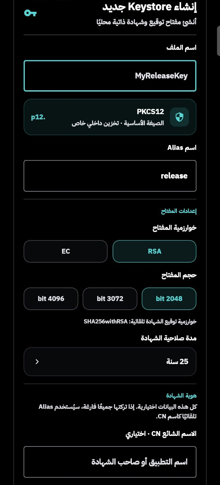

Shueibhub | Forge

Independent Developer · Android Apps · Software Projects

Building practical software with a focus on simplicity, usefulness, and a clean user experience.

"GitHub Profile" (https://github.com/ShueibHub) · "All Repositories" (https://github.com/ShueibHub?tab=repositories)

---

About

Shueibhub | Forge is the personal development space of ShueibHub.

This repository brings together selected projects, applications, and experiments. The goal is straightforward: build useful tools, keep them simple, and improve them through real feedback.

Projects

KeyForge

An Android utility for working with Android keystores and app signing.

- Designed to keep core functionality on the user's device.
- No advertising, in-app purchases, or private application servers.
- Uses GitHub to check for update information.

Download: "KeyForge v1.0" (https://github.com/ShueibHub/ShueibHub-Forge/releases/download/1.0/KeyForge-v1.0.apk)

  
  
  
  

ProgForge

A programming-focused keyboard for Android, designed to make coding on mobile devices easier, faster, and more comfortable.

- Provides convenient access to programming symbols and characters.
- Designed with developers and programmers in mind.
- Aims to improve the mobile coding experience.
- Makes essential coding characters readily accessible while typing.

  
  
  
  
  

More work

Other repositories and experiments are available on the "ShueibHub GitHub profile" (https://github.com/ShueibHub?tab=repositories). This page will be updated as projects are published.

Approach

- Useful first: focus on solving a real problem.
- Simple by design: avoid unnecessary complexity.
- Privacy-conscious: be clear about how an app handles user data.
- Continuous improvement: listen to feedback and refine projects over time.

Contact & Links

- GitHub: "@ShueibHub" (https://github.com/ShueibHub)
- Projects: "github.com/ShueibHub" (https://github.com/ShueibHub?tab=repositories)

---

العربية

ShueibHub | Forge مساحة تطوير مستقلة خاصة بـ ShueibHub، تضم مجموعة من التطبيقات والمشاريع والتجارب البرمجية.

نركز على بناء أدوات عملية وسهلة الاستخدام، مع الاهتمام بالبساطة والخصوصية وتحسين تجربة المستخدم.

المشاريع

KeyForge — تطبيق Android لإدارة مفاتيح التوقيع وملفات Keystore والتحقق من توقيع التطبيقات.

- يعمل جوهريًا على جهاز المستخدم.
- بدون إعلانات أو مشتريات داخل التطبيق أو خوادم خاصة.
- يستخدم GitHub للحصول على معلومات التحديثات.

"تحميل KeyForge v1.0" (https://github.com/ShueibHub/ShueibHub-Forge/releases/download/1.0/KeyForge-v1.0.apk)

ProgForge — لوحة مفاتيح مخصصة للبرمجة على أجهزة Android، صُممت لجعل كتابة الأكواد أسهل وأسرع وأكثر راحة.

- توفر وصولًا سهلًا إلى الرموز والمحارف البرمجية.
- مصممة لتلبية احتياجات المبرمجين والمطورين.
- تهدف إلى تحسين تجربة البرمجة باستخدام الهواتف.
- تجعل المحارف الأساسية للبرمجة متاحة بسهولة أثناء الكتابة.

للاطلاع على بقية المشاريع والتجارب، تفضل بزيارة "جميع مستودعات ShueibHub" (https://github.com/ShueibHub?tab=repositories).

---

Made with care by ShueibHub.

